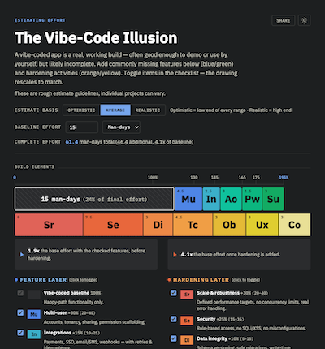

# The Vibe-Code Illusion

A vibe-coded app is a real, working build — often good enough to demo or use by yourself, but likely incomplete. On the page, you can add commonly missing features (blue/green) and any hardening activities (orange/yellow). The drawing rescales to match.

These are rough estimate guidelines, individual projects can vary.  Comments and suggestions are welcome.

